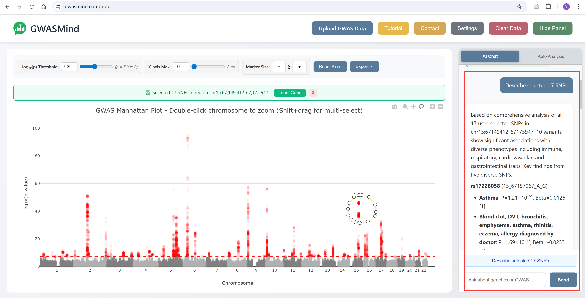
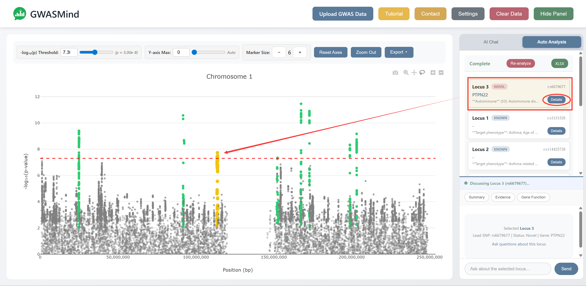

<p align="center">
  
</p>

<h1 align="center">GWASMind</h1>

<p align="center">
  Traceable, agentic interpretation of GWAS loci with Open Targets evidence and a two-stage review
</p>

<p align="center">
  
  
  
  <a href="LICENSE"></a>
</p>

GWASMind is a local, agentic system for the traceable interpretation of
genome-wide association study (GWAS) loci. It answers two questions about a
locus:

- **Prior-association screening:** has this locus been reported before for the
  phenotype of interest (Known, Novel within the screened scope, or Unresolved)?
- **Candidate-gene prioritization:** which genes at the locus are the most
  plausible effector genes, and what evidence supports or is missing for each?

A large language model (LLM) resolves each natural-language question into a
task and a biological context. Deterministic, task-specific plans then retrieve
evidence through typed semantic tools, with
[Open Targets](https://platform.opentargets.org/) as the primary data layer.
Every statement in a report is linked to the retrieved source records, and each
analysis passes through a two-stage review: **evidence review** before
interpretation and **report verification** after generation.

> GWASMind does not establish causal genes. Its outputs are ranked hypotheses
> together with their supporting and missing evidence, intended to guide
> genetic and experimental follow-up.

<p align="center">
  
</p>

## Contents

- [Features](#features)
- [Installation](#installation)
- [Getting started](#getting-started)
- [Evidence modes](#evidence-modes)
- [Two-stage review](#two-stage-review)
- [Configuration and reproducibility](#configuration-and-reproducibility)
- [Privacy and security](#privacy-and-security)
- [Repository layout](#repository-layout)
- [Building the Windows installer](#building-the-windows-installer)
- [Documentation](#documentation)
- [Citation and contact](#citation-and-contact)
- [License](#license)

## Features

- **Interactive Manhattan plot.** Upload summary statistics and select variants
  with box or freehand selection; files are parsed in the browser.
- **AI Chat.** Ask about the selected variants, for example *"What traits are
  associated with these selected variants?"* or *"Prioritize the putatively
  causal genes for these variants."*
- **Auto Analysis.** Screen many loci for prior associations in one batch and
  export the results to Excel.
- **Evidence-linked reports.** Findings with numbered citations, warnings,
  limitations and the weakest link of each prioritized gene; exports as
  Markdown, figures or spreadsheets.
- **Live or frozen evidence.** Query the current Open Targets release, or a
  verified local snapshot for reproducible, time-bounded analyses.
- **Any OpenAI-compatible model.** DeepSeek, OpenAI, OpenRouter, Google Gemini,
  Mistral, locally hosted models and more, with per-model reasoning controls.
- **Full provenance.** Each run records its configuration, evidence release,
  tool requests, retrieved records, model requests and responses, and review
  actions.
- **MCP server.** The same semantic Open Targets tools can be served to other
  Model Context Protocol clients.

<p align="center">
  
</p>

## Installation

### Windows installer (recommended on Windows)

Download [`installer/GWASMind-1.0.0-Setup.exe`](installer/GWASMind-1.0.0-Setup.exe)
and run it. It installs GWASMind for the current user, without administrator
rights, together with its own Python runtime and dependencies, and adds a
Start-menu entry (and optionally a desktop shortcut). `GWASMind.exe` starts the
local service and opens the interface in your browser.

Analyses, history and saved settings are kept in the installation folder (by
default `%LOCALAPPDATA%\GWASMind`). Upgrading keeps them; uninstalling asks
whether to delete them. To verify the download, compare its SHA-256 hash
(`Get-FileHash GWASMind-1.0.0-Setup.exe`) with
[`installer/GWASMind-1.0.0-Setup.exe.sha256`](installer/GWASMind-1.0.0-Setup.exe.sha256).

> The installer is not code-signed. If Windows SmartScreen reports an
> unrecognized app, choose **More info → Run anyway**.

### From source on Windows

Requires Python 3.11 or newer. Clone this repository into a short folder such
as `C:\GWASMind` (or use **Code → Download ZIP** and extract it there), then:

```powershell
cd C:\GWASMind
.\start_gwasmind.bat
```

On first use the launcher creates `.venv`, installs GWASMind and its
dependencies, starts the local service on a loopback address and opens the
interface. Other launcher modes:

```powershell
.\start_gwasmind.bat -Mode Menu                 # interactive menu
.\start_gwasmind.bat -Mode FrozenWebUI -FrozenDataRoot D:\opentargets\25.09
.\start_gwasmind.bat -Mode Help
```

### Linux and macOS

Clone this repository, then from its folder:

```bash
python -m venv .venv && source .venv/bin/activate
pip install -e ".[all]"
gwasmind-ui --open-browser
```

With an editable install, analysis history and run records are kept in the
repository folder (`data/history` and `artifacts/web_runs`);
`gwasmind-ui --artifact-root <path>` selects another location for run records.

### Requirements

- Python 3.11, 3.12 or 3.13 (bundled with the Windows installer).
- Network access to the Open Targets GraphQL API (live mode) and to your model
  endpoint. A locally hosted OpenAI-compatible model and a local Open Targets
  snapshot can be used instead.
- **Windows long paths.** Saved analyses use nested, hash-named folders that can
  exceed the default 260-character limit. Install in a short folder and enable
  long paths once, in PowerShell opened with **Run as administrator**:

  ```powershell
  New-ItemProperty -Path "HKLM:\SYSTEM\CurrentControlSet\Control\FileSystem" -Name "LongPathsEnabled" -Value 1 -PropertyType DWORD -Force
  ```

  The launcher and `GWASMind.exe` warn when long paths are disabled.

## Getting started

1. **Configure a model.** Open **Settings**, choose a provider and model, enter
   your API key and select **Save & Test**. Keys are held in the memory of the
   local service and are never written to browser storage, logs or exported
   results. On Windows, a configuration that passes Save & Test is also kept in
   `.gwasmind\credentials\model.dpapi`, encrypted for your Windows account, and
   is re-tested once at the next start; delete that file to forget the key.
   Alternatively, set `GWASMIND_MODEL_API_KEY_ENV`, `GWASMIND_MODEL_BASE_URL`
   and `GWASMIND_MODEL_ID` before starting (see [`.env.example`](.env.example)).
2. **Load data.** Upload GWAS summary statistics (CSV, TSV or TXT with
   chromosome, GRCh38 position, P value, reference and alternate alleles; rsIDs
   and effect sizes are optional), or open the bundled asthma or depression
   demo.
3. **Ask.** Select variants on the Manhattan plot and ask in **AI Chat**, or
   upload a list of loci in **Auto Analysis** (the bundled asthma demo has eight
   loci on chromosome 1).
4. **Review.** Read the findings, citations, warnings and limitations; label
   genes on the plot; export figures, the chat (Markdown) or batch results
   (Excel).

An illustrated tutorial is available from the **Tutorial** button and in
[`src/gwasmind/web/static/docs/tutorial.md`](src/gwasmind/web/static/docs/tutorial.md).

The command-line interface runs the same analysis on a locus file:

```bash
gwasmind analyze --input examples/locus.live.asthma.json --mode live \
  --ranker deterministic --defer-ranking --output-dir runs/example
```

## Evidence modes

| Mode | Evidence source | Intended use |
|---|---|---|
| `live` (default) | Official Open Targets GraphQL API at analysis time; the release used is recorded. | Current exploratory analysis |
| `frozen-safe` | A versioned local Open Targets snapshot with a verified `gwasmind_snapshot_manifest.json`, queried with DuckDB. | Reproducibility and temporal cut-offs |

The two modes never fall back to each other silently, and a query that
succeeded with no records is reported differently from one that could not be
completed. To use a local snapshot (Open Targets Platform Parquet datasets):

```bash
pip install -e ".[local,mcp]"
gwasmind inspect-snapshot --data-root D:/opentargets/25.09 --release 25.09 \
  --output D:/opentargets/25.09/gwasmind_snapshot_manifest.json
gwasmind-ui --default-mode frozen-safe --frozen-data-root D:/opentargets/25.09
```

`inspect-snapshot` refuses to create a manifest when any Parquet file is
truncated or damaged. With the Windows installer, use
`GWASMind.exe cli inspect-snapshot ...` and
`GWASMind.exe --default-mode frozen-safe --frozen-data-root <folder>`.

The semantic tools can also be served to other MCP clients:

```bash
gwasmind serve-mcp --mode live
```

## Two-stage review

- **Evidence review** (before interpretation) stops an analysis only when no
  source variant can be verified, no usable evidence is available or the
  candidate window contains no gene. Otherwise it reports warnings (W1–W9), for
  example missing locus-to-gene support, source associations below genome-wide
  significance or no tissue-matched evidence, and carries them into the report.
- **Report verification** (after generation) checks identifiers, numerical
  values, citations and tied ranks against the retrieved records. Errors
  attributable to a single source are corrected, unsupported identifiers and
  citations are removed, and ambiguous assignments are flagged. The candidate
  order and ties are preserved.

## Configuration and reproducibility

Behaviour is fixed by three versioned configuration catalogs:

| File | Content |
|---|---|
| [`src/gwasmind/config/parameters.toml`](src/gwasmind/config/parameters.toml) | Retrieval, LD, ranking and runtime parameters |
| [`src/gwasmind/prompts/llm_prompts.toml`](src/gwasmind/prompts/llm_prompts.toml) | LLM prompts |
| [`src/gwasmind/config/gate_rules.toml`](src/gwasmind/config/gate_rules.toml) | Review rules (stops, warnings and verification) |

The catalogs are frozen: [`docs/CONFIG_FREEZE_2026-09-28.json`](docs/CONFIG_FREEZE_2026-09-28.json)
records their hashes and key scientific thresholds, and the service warns at
start-up if a catalog has drifted (`python -m gwasmind.config_freeze` prints the
report). `GWASMIND_PARAMETERS_FILE` may point to a file of local overrides.

Each analysis records its configuration, evidence release, model identifier and
settings, tool requests, retrieved records, model requests and responses, and
review actions. Because LLM outputs are stochastic and Open Targets is updated
regularly, a new online analysis is an independent run; archived records allow
earlier results to be inspected and recomputed.

## Privacy and security

- The local web service binds only to a loopback address and accepts
  same-origin requests.
- Uploaded summary statistics stay on your computer; only the selected variants
  and task-specific requests are sent to the configured evidence and model
  services.
- Request sizes, loci, variants and candidates are bounded and validated.

## Repository layout

```text
src/gwasmind/     Python package: agent, evidence providers, review, web service and interface
  config/         parameters.toml, gate_rules.toml and other packaged configuration
  prompts/        LLM prompt catalog
  data/           packaged reference data (gene coordinates, biosamples, phenotype contexts, LLM list)
  web/            local web service, templates, static assets, demo data and tutorial
installer/        Windows installer (GWASMind-1.0.0-Setup.exe) and its SHA-256 checksum
examples/         example locus inputs for the command line
docs/             usage documentation and the configuration freeze list
scripts/          scripts that rebuild the packaged demo data and gene-coordinate table
packaging/        source of the Windows installer (build script, Inno Setup script, launcher, icon)
start_gwasmind.*  one-click Windows launcher
```

## Building the Windows installer

Install [Inno Setup 6](https://jrsoftware.org/isinfo.php) and run
`powershell -ExecutionPolicy Bypass -File packaging\build_installer.ps1` in a
clone of this repository. It downloads the official CPython runtime and the
dependencies, builds from the committed files only, and writes the installer
and its SHA-256 checksum to `dist\`.

## Documentation

- [`docs/README.md`](docs/README.md): index of the documentation
- [`src/gwasmind/web/static/docs/tutorial.md`](src/gwasmind/web/static/docs/tutorial.md): illustrated tutorial (also under **Tutorial** in the interface)
- [`docs/API_SETTINGS.md`](docs/API_SETTINGS.md): model settings and reasoning controls
- [`docs/CONFIGURATION_AND_GATES.md`](docs/CONFIGURATION_AND_GATES.md): configuration, local overrides and review rules
- [`docs/LLM_AND_TOOL_ROUTING.md`](docs/LLM_AND_TOOL_ROUTING.md): what the LLM decides and what deterministic tools do
- [`docs/MCP_TOOL_DESIGN.md`](docs/MCP_TOOL_DESIGN.md): the semantic Open Targets tools served over MCP
- [`docs/LOCAL_HISTORY.md`](docs/LOCAL_HISTORY.md): where analyses and history are stored

## Citation and contact

A manuscript describing GWASMind is in preparation; citation details will be
added here on publication.

GWASMind is developed by the [Erping Long Lab](https://sites.google.com/view/erping-long-lab/)
at the Institute of Basic Medical Sciences, Chinese Academy of Medical Sciences
& Peking Union Medical College, Beijing. Please report problems through the
issue tracker; for other enquiries, contact Professor Erping Long
(erping.long@ibms.pumc.edu.cn).

## License

GWASMind is released under the [MIT License](LICENSE). Bundled third-party
browser libraries in `src/gwasmind/web/static/js/vendor/` keep their own
licenses.
